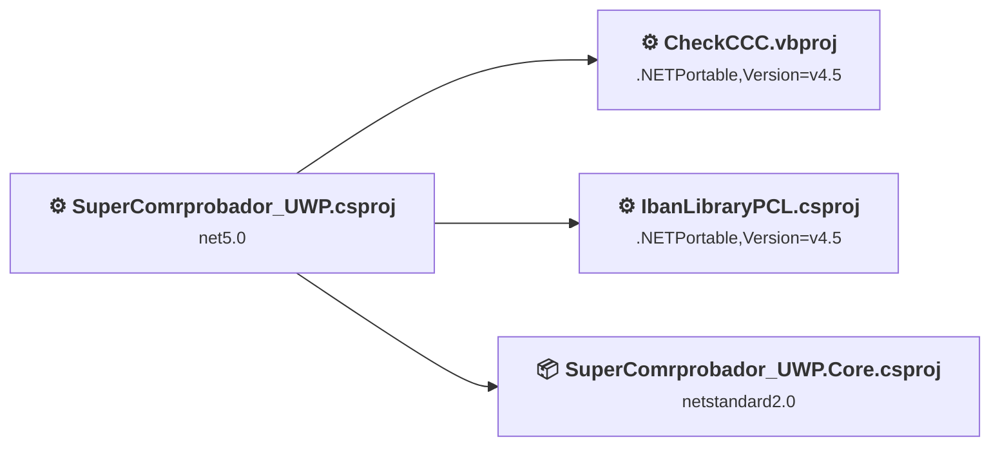
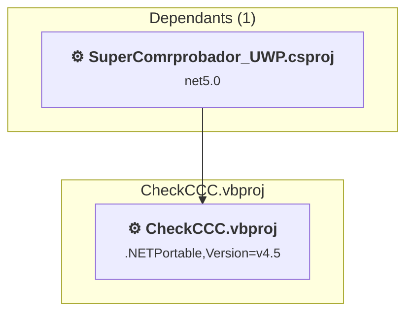
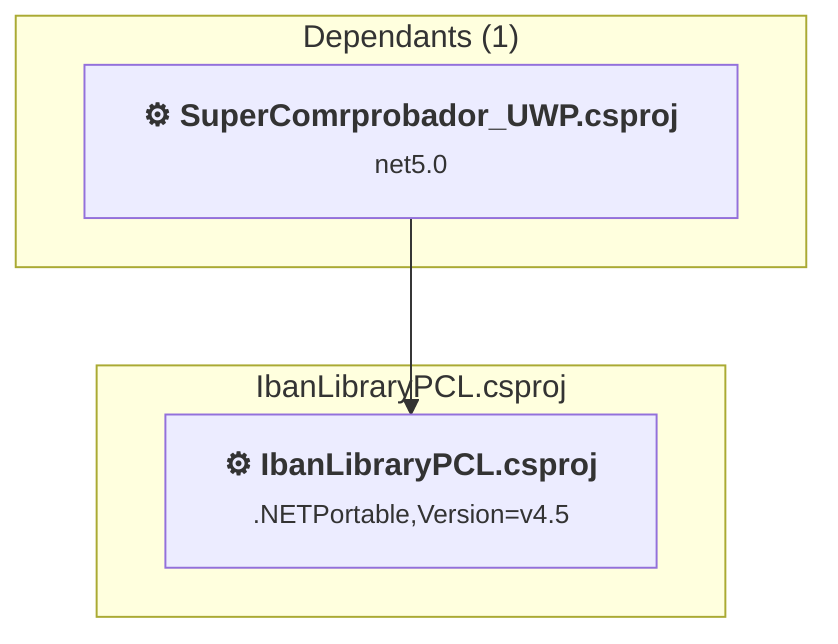
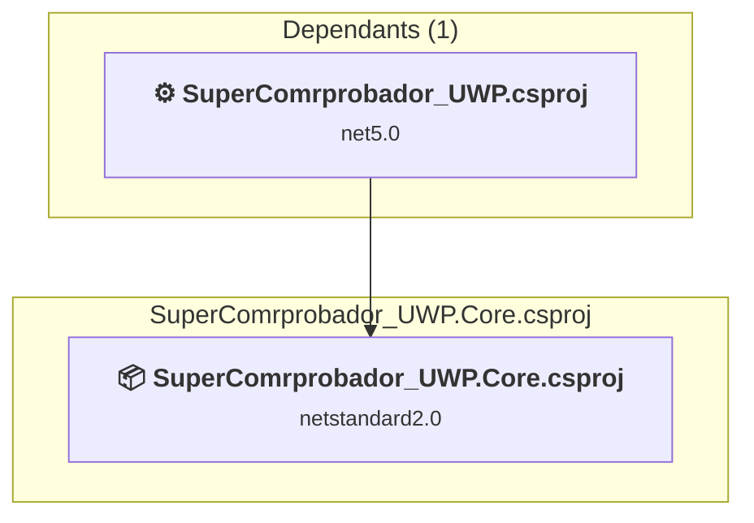
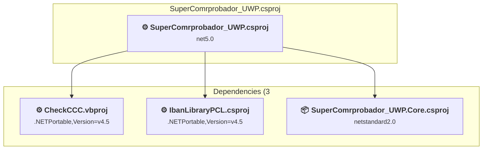

# Projects and dependencies analysis

This document provides a comprehensive overview of the projects and their dependencies in the context of upgrading to .NETCoreApp,Version=v10.0.

## Table of Contents

- [Executive Summary](#executive-Summary)
  - [Highlevel Metrics](#highlevel-metrics)
  - [Projects Compatibility](#projects-compatibility)
  - [Package Compatibility](#package-compatibility)
  - [API Compatibility](#api-compatibility)
- [Aggregate NuGet packages details](#aggregate-nuget-packages-details)
- [Top API Migration Challenges](#top-api-migration-challenges)
  - [Technologies and Features](#technologies-and-features)
  - [Most Frequent API Issues](#most-frequent-api-issues)
- [Projects Relationship Graph](#projects-relationship-graph)
- [Project Details](#project-details)

  - [CheckCCC\CheckCCC.vbproj](#checkccccheckcccvbproj)
  - [IbanLibraryPCL\IbanLibraryPCL.csproj](#ibanlibrarypclibanlibrarypclcsproj)
  - [SuperComrprobador_UWP.Core\SuperComrprobador_UWP.Core.csproj](#supercomrprobador_uwpcoresupercomrprobador_uwpcorecsproj)
  - [SuperComrprobador_UWP\SuperComrprobador_UWP.csproj](#supercomrprobador_uwpsupercomrprobador_uwpcsproj)

## Executive Summary

### Highlevel Metrics

| Metric | Count | Status |
| :--- | :---: | :--- |
| Total Projects | 4 | All require upgrade |
| Total NuGet Packages | 5 | 2 need upgrade |
| Total Code Files | 33 |  |
| Total Code Files with Incidents | 10 |  |
| Total Lines of Code | 1615 |  |
| Total Number of Issues | 21 |  |
| Estimated LOC to modify | 11+ | at least 0,7% of codebase |

### Projects Compatibility

| Project | Target Framework | Difficulty | Package Issues | API Issues | Est. LOC Impact | Description |
| :--- | :---: | :---: | :---: | :---: | :---: | :--- |
| [CheckCCC\CheckCCC.vbproj](#checkccccheckcccvbproj) | .NETPortable,Version=v4.5 | 🟢 Low | 0 | 0 |  | ClassicClassLibrary, Sdk Style = False |
| [IbanLibraryPCL\IbanLibraryPCL.csproj](#ibanlibrarypclibanlibrarypclcsproj) | .NETPortable,Version=v4.5 | 🟢 Low | 0 | 0 |  | ClassicClassLibrary, Sdk Style = False |
| [SuperComrprobador_UWP.Core\SuperComrprobador_UWP.Core.csproj](#supercomrprobador_uwpcoresupercomrprobador_uwpcorecsproj) | netstandard2.0 | 🟢 Low | 2 | 0 |  | ClassLibrary, Sdk Style = True |
| [SuperComrprobador_UWP\SuperComrprobador_UWP.csproj](#supercomrprobador_uwpsupercomrprobador_uwpcsproj) | net5.0 | 🟢 Low | 2 | 11 | 11+ | Uwp, Sdk Style = False |

### Package Compatibility

| Status | Count | Percentage |
| :--- | :---: | :---: |
| ✅ Compatible | 3 | 60,0% |
| ⚠️ Incompatible | 1 | 20,0% |
| 🔄 Upgrade Recommended | 1 | 20,0% |
| ***Total NuGet Packages*** | ***5*** | ***100%*** |

### API Compatibility

| Category | Count | Impact |
| :--- | :---: | :--- |
| 🔴 Binary Incompatible | 0 | High - Require code changes |
| 🟡 Source Incompatible | 1 | Medium - Needs re-compilation and potential conflicting API error fixing |
| 🔵 Behavioral change | 10 | Low - Behavioral changes that may require testing at runtime |
| ✅ Compatible | 1461 |  |
| ***Total APIs Analyzed*** | ***1472*** |  |

## Aggregate NuGet packages details

| Package | Current Version | Suggested Version | Projects | Description |
| :--- | :---: | :---: | :--- | :--- |
| Microsoft.NETCore.UniversalWindowsPlatform | 6.2.12 |  | [SuperComrprobador_UWP.csproj](#supercomrprobador_uwpsupercomrprobador_uwpcsproj) | Needs to be replaced with Replace with new package Microsoft.WindowsAppSDK=2.1.3;Microsoft.Graphics.Win2D=1.1.0;Microsoft.Windows.Compatibility=10.0.8 |
| Microsoft.Services.Store.Engagement | 10.1901.28001 |  | [SuperComrprobador_UWP.csproj](#supercomrprobador_uwpsupercomrprobador_uwpcsproj) | ✅Compatible |
| Microsoft.Xaml.Behaviors.Uwp.Managed | 2.0.1 |  | [SuperComrprobador_UWP.csproj](#supercomrprobador_uwpsupercomrprobador_uwpcsproj) | ⚠️El paquete NuGet no es compatible |
| NETStandard.Library | 2.0.3 |  | [SuperComrprobador_UWP.Core.csproj](#supercomrprobador_uwpcoresupercomrprobador_uwpcorecsproj) | ✅Compatible |
| Newtonsoft.Json | 12.0.3 | 13.0.4 | [SuperComrprobador_UWP.Core.csproj](#supercomrprobador_uwpcoresupercomrprobador_uwpcorecsproj) | Se recomienda actualizar el paquete NuGet |

## Top API Migration Challenges

### Technologies and Features

| Technology | Issues | Percentage | Migration Path |
| :--- | :---: | :---: | :--- |

### Most Frequent API Issues

| API | Count | Percentage | Category |
| :--- | :---: | :---: | :--- |
| T:System.Uri | 5 | 45,5% | Behavioral Change |
| M:System.Uri.#ctor(System.String) | 5 | 45,5% | Behavioral Change |
| T:System.WindowsRuntimeSystemExtensions | 1 | 9,1% | Source Incompatible |

## Projects Relationship Graph

Legend:
📦 SDK-style project
⚙️ Classic project

## Project Details

### CheckCCC\CheckCCC.vbproj

#### Project Info

- **Current Target Framework:** .NETPortable,Version=v4.5
- **Proposed Target Framework:** net10.0
- **SDK-style**: False
- **Project Kind:** ClassicClassLibrary
- **Dependencies**: 0
- **Dependants**: 1
- **Number of Files**: 3
- **Number of Files with Incidents**: 1
- **Lines of Code**: 129
- **Estimated LOC to modify**: 0+ (at least 0,0% of the project)

#### Dependency Graph

Legend:
📦 SDK-style project
⚙️ Classic project

### API Compatibility

| Category | Count | Impact |
| :--- | :---: | :--- |
| 🔴 Binary Incompatible | 0 | High - Require code changes |
| 🟡 Source Incompatible | 0 | Medium - Needs re-compilation and potential conflicting API error fixing |
| 🔵 Behavioral change | 0 | Low - Behavioral changes that may require testing at runtime |
| ✅ Compatible | 26 |  |
| ***Total APIs Analyzed*** | ***26*** |  |

### IbanLibraryPCL\IbanLibraryPCL.csproj

#### Project Info

- **Current Target Framework:** .NETPortable,Version=v4.5
- **Proposed Target Framework:** net10.0
- **SDK-style**: False
- **Project Kind:** ClassicClassLibrary
- **Dependencies**: 0
- **Dependants**: 1
- **Number of Files**: 3
- **Number of Files with Incidents**: 1
- **Lines of Code**: 325
- **Estimated LOC to modify**: 0+ (at least 0,0% of the project)

#### Dependency Graph

Legend:
📦 SDK-style project
⚙️ Classic project

### API Compatibility

| Category | Count | Impact |
| :--- | :---: | :--- |
| 🔴 Binary Incompatible | 0 | High - Require code changes |
| 🟡 Source Incompatible | 0 | Medium - Needs re-compilation and potential conflicting API error fixing |
| 🔵 Behavioral change | 0 | Low - Behavioral changes that may require testing at runtime |
| ✅ Compatible | 281 |  |
| ***Total APIs Analyzed*** | ***281*** |  |

### SuperComrprobador_UWP.Core\SuperComrprobador_UWP.Core.csproj

#### Project Info

- **Current Target Framework:** netstandard2.0✅
- **SDK-style**: True
- **Project Kind:** ClassLibrary
- **Dependencies**: 0
- **Dependants**: 1
- **Number of Files**: 2
- **Number of Files with Incidents**: 1
- **Lines of Code**: 45
- **Estimated LOC to modify**: 0+ (at least 0,0% of the project)

#### Dependency Graph

Legend:
📦 SDK-style project
⚙️ Classic project

### API Compatibility

| Category | Count | Impact |
| :--- | :---: | :--- |
| 🔴 Binary Incompatible | 0 | High - Require code changes |
| 🟡 Source Incompatible | 0 | Medium - Needs re-compilation and potential conflicting API error fixing |
| 🔵 Behavioral change | 0 | Low - Behavioral changes that may require testing at runtime |
| ✅ Compatible | 18 |  |
| ***Total APIs Analyzed*** | ***18*** |  |

### SuperComrprobador_UWP\SuperComrprobador_UWP.csproj

#### Project Info

- **Current Target Framework:** net5.0
- **Proposed Target Framework:** net10.0-windows10.0.26100.0
- **SDK-style**: False
- **Project Kind:** Uwp
- **Dependencies**: 3
- **Dependants**: 0
- **Number of Files**: 40
- **Number of Files with Incidents**: 7
- **Lines of Code**: 1116
- **Estimated LOC to modify**: 11+ (at least 1,0% of the project)

#### Dependency Graph

Legend:
📦 SDK-style project
⚙️ Classic project

### API Compatibility

| Category | Count | Impact |
| :--- | :---: | :--- |
| 🔴 Binary Incompatible | 0 | High - Require code changes |
| 🟡 Source Incompatible | 1 | Medium - Needs re-compilation and potential conflicting API error fixing |
| 🔵 Behavioral change | 10 | Low - Behavioral changes that may require testing at runtime |
| ✅ Compatible | 1136 |  |
| ***Total APIs Analyzed*** | ***1147*** |  |

